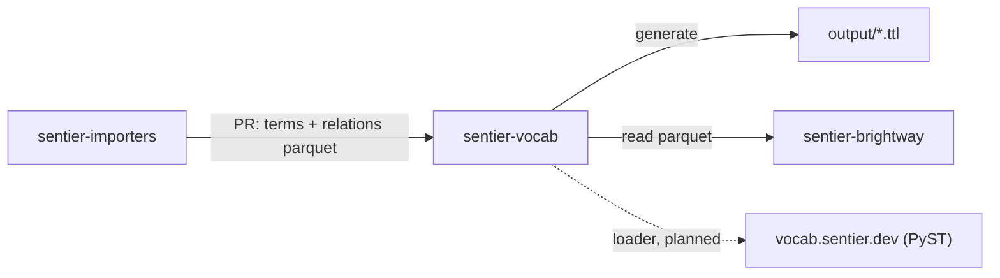

# sentier-vocab



## What it is

- One canonical IRI per term under `https://vocab.sentier.dev/`: flows, units, products, processes, LCIA methods, impact categories, organisms, and more.
- Two parquet layers hold everything: `terms/` (one row per term, any type) and `relations/` (one row per directed edge between terms). Both are cut per source release.
- Two plain YAML contracts describe them: `schemas/term.yaml` lists the term columns and the allowed term types (IRI namespace, attribute keys); `schemas/relation.yaml` lists the edge columns and the allowed predicates (subject and object types). `app/sentier_vocab/iris.py` reads the namespaces from `term.yaml`; they never change without a migration.
- Bulk terms arrive as parquet through `sentier-importers` pull requests, not by hand. Correspondences to other identifier spaces (Brightway, ecoinvent) live in `sentier-mappings`, characterization factors in `sentier-methods`, exchanges in `sentier-inventory`.

## Install

Not on PyPI. Clone, then sync:

```bash
git clone https://github.com/sentier-dev/sentier-vocab.git
```

```bash
uv sync
```

## Use

Check both layers against the contracts (IRI unique, type listed, IRI in the type's namespace, attribute keys declared, every edge resolves, one source per file, one unit per flow):

```bash
uv run python -m sentier_vocab validate
```

Validate, then write `output/*.ttl` (`--output-dir DIR` writes elsewhere):

```bash
uv run python -m sentier_vocab generate
```

Regenerate the coverage matrix `docs/COVERAGE.md`. `uv run sentier-vocab <command>` is the same CLI:

```bash
uv run python -m sentier_vocab coverage
```

Fetch the external ontologies and run the transitional importers. They write `app/sentier_vocab/importers/output/*.ttl`, which `generation-test.yml` copies to the legacy Fuseki on push to `main`:

```bash
uv run bash scripts/generate.sh
```

## Read the data

The `terms/` directory is one parquet dataset; filter on `type` instead of picking a folder. Type-specific literals sit in the `attributes` JSON column; links to other terms are rows of `relations/`.

```python
import json
import pandas as pd

flows = pd.read_parquet("terms", filters=[("type", "==", "elementary-flow")])
attrs = flows["attributes"].map(lambda s: json.loads(s) if s else {})
flows["compartment"] = attrs.map(lambda a: a.get("compartment"))
units = pd.read_parquet("relations", filters=[("predicate", "==", "qudt:hasUnit")])
```

## Layout

| Path | Holds |
|---|---|
| `app/sentier_vocab/` | Package. `schema.py` loads the contracts, `layers.py` reads and writes parquet, `validate.py`, `generate.py`, `coverage.py`, `iris.py`, `__main__.py` CLI, `importers/` with its own `output/`. |
| `schemas/` | `term.yaml` and `relation.yaml`, the two contracts. |
| `terms/` | `<release>.parquet` or `<release>-NN.parquet`: every term of one source release, all types mixed. |
| `relations/` | `<release>.parquet`: every edge of one source release, all predicates mixed. |
| `output/` | Generated TTL. `<category>.ttl` (sentier-core) is committed. `<category>.<stem>.ttl` is gitignored. |
| `.github/workflows/` | `ci.yml` PR gate, `generation-test.yml` importer TTL deploy, `python-test.yml`, `python-package-deploy.yml`. |

## Data

- A file belongs to one source release and its stem is the source term's identifier (`ef-3.1`, `bafu-2026`, `foodex2`, `agribalyse-3.2`, `sentier-core` for terms Sentier curates itself). A delivery replaces its own files whole.
- Term columns: `iri, type, pref_label, alt_labels, definition, notation, additional_notations, source, status, attributes`. Relation columns: `subject, predicate, object, source, status`.
- A relation's object is a `vocab.sentier.dev` IRI or an external IRI allow-listed on the predicate (QUDT units, geonames, OBO). Tool identifiers are never relation objects; they go to `sentier-mappings`.
- Files stay under 3 MB (`check-added-large-files --maxkb=3000`). Shard with a `-NN` suffix, never git-LFS.
- Regenerate `output/` and `docs/COVERAGE.md` in the same PR as any `terms/`, `relations/` or `schemas/` change. CI fails otherwise.

## Contributing

Format, then test:

```bash
uv run --extra dev pre-commit run --all-files
```

```bash
uv run --extra testing pytest
```

- See [CONTRIBUTING.md](CONTRIBUTING.md) and file bugs on the [issue tracker](https://github.com/sentier-dev/sentier-vocab/issues).
- Docs are Sphinx. The conda env is `docs/environment.yaml` (`sphinx_svd`); build with `sphinx-build docs _build/html`.

## License

Distributed under the terms of the [MIT license][License],
_svd_ is free and open source software.

[License]: LICENSE
